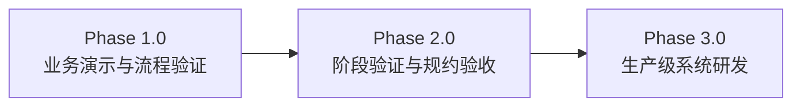
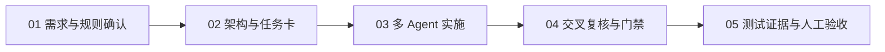

<!-- Claude 2026-11-01: 内容照搬 api-cloud.cc 首页，各节"详细内容"跳转博客 -->

  

  

## Hi，我是 Pitt (Parker) 👋

**AI 原生工程与企业 AI 转型** —— 以 10+ 年企业 IT 基础设施经验为底座，结合可复用的多 Agent 工程工作流，连接 AI 架构规划、治理与真实业务系统交付。

- 🧱 **10+ 年**工程经验：药企高合规环境、军工高密级环境、金融科技支付系统
- 🌐 **12 节点**全球自建网络，**50 个** IPv6 自适应入口
- 🤖 **4 AI** 多 Agent 协同交付：Claude · Codex · Gemini · Grok
- 🏭 制造企业销售数字化平台：1.0 演示 → 2.0 验收 → **3.0 生产部署推进中**
- 📝 我的博客：[api-cloud.cc](https://api-cloud.cc) · [关于我](https://api-cloud.cc/about.html)

  

## ✨ 关注方向

  

## ✨ 我如何推动企业 AI 落地

从技术投资、基础设施和治理约束出发，把 AI 方案逐步转化为可运行、可验证的工程系统。

| | 方向 | 内容 |
|:-:|---|---|
| 🧭 | **架构规划与成本路线** | 本地与云端协同、方案评估、分阶段投资和资源利旧 |
| 🖥️ | **基础设施与算力工程** | Linux、网络、容器、GPU、备份及可观测性 |
| 🔐 | **安全、数据与 AI 治理** | 访问控制、知识资产、模型路由与审计的工程化设计 |
| 🚀 | **业务系统与工程交付** | 从业务需求、交互验证到可持续演进的软件架构 |

 

👉 [详细内容](https://api-cloud.cc/#what-i-build)

  

## ✨ 核心业务实战：传统制造企业销售数字化平台

将线下业务规则落地为可运行的软件系统：1.0 上线演示，2.0 通过阶段验收，3.0 正在推进生产部署。

> **业务落地价值**：打通传统制造企业从非标询价、阶梯成本核算到多级风控审批断点，将跨部门报价流转周期从 **3 天缩短至 15 分钟**，实现全链路订单履约与数据权限严格隔离。

| 非标规格自动匹配率 | 多角色算价与审批 SLA | 行级租户与权限隔离 |
|:-:|:-:|:-:|
| **99.4%** | **< 15 min** | **100%** |

 

👉 [详细内容](https://api-cloud.cc/#featured-case) · [完整案例](https://api-cloud.cc/case-studies.html)

  

## ✨ 让多个 AI 按工程规则协作

  
  &nbsp;&nbsp;&nbsp;
  
  &nbsp;&nbsp;&nbsp;
  
  &nbsp;&nbsp;&nbsp;
  <picture><source media="(prefers-color-scheme: dark)" srcset="assets/grok-dark.png"></picture>
   
  Claude · Codex · Gemini · Grok

方案先审、任务拆解、交叉验证、官方资料核对与自动化门禁；每一步由日志、测试和人工 PASS 决定是否继续。

 

👉 [详细内容](https://api-cloud.cc/#delivery-engine)

  

## ✨ 运行中的 AI 与基础设施实践

个人工程实践与企业数字化方案协同落地，验证从架构设计、自动化流水线到线上生产环境的工程闭环。

| | 系统 | 说明 |
|:-:|---|---|
| 📚 | **官方文档知识库 + MCP** | 整理官方来源并提供带出处的检索与核验接口，辅助 Agent 降低旧资料依赖 |
| 🛡️ | **AI Hook 门禁体系** | 核验官方文档调用与代码检查，降低自动执行过程中的失控和遗漏 |
| 🌐 | **多节点安全运维** | 自动化访问控制、日志联动、逐台验证与可回滚变更 |
| ⚙️ | **K3s 故障切换与可观测 Lab** | 验证多入口故障切换与监测链路，沉淀可复用的部署与排障实践 |

**开源项目：[gemini-mcp-docs-agent](https://github.com/pittzhang20260507/gemini-mcp-docs-agent)** —— 只依据官方文档回答运维问题、并给出精确出处的 MCP 服务 + Agent（Gemini + Vertex AI Search）。

 

👉 [详细内容](https://api-cloud.cc/#running-systems) · [K8S 可观察平台](https://api-cloud.cc/k8s-observability.html)

  

## ✨ 十余年的工程底座

Linux、网络、安全、云原生和 SRE 可观测性，为 AI 应用提供部署、排障与长期运营的能力基础。

  

 

👉 [浏览经典工程案例](https://api-cloud.cc/case-studies.html)

  

## ✨ 技术文章与工程思考

记录真实实验、技术取舍和 AI 工作流方法，持续从实践中修正认知。

- 🧠 [AI Agent 的第二道门槛：当能力开始超过边界](https://api-cloud.cc/blog-agent-second-threshold.html)
- 🏗️ [当 AI 跌入凡间：AI 时代真正需要什么基础设施？](https://api-cloud.cc/blog-ai-mortal-infrastructure.html)
- 🔗 [AI 企业落地的真正分水岭：不是本地还是云端，而是链路有多长](https://api-cloud.cc/blog-enterprise-ai-long-horizon-watershed.html)
- 📄 [AI 应用开发项目：从征信 PDF 到结构化 JSON 的多模型智能处理系统](https://api-cloud.cc/blog-credit-report-multi-model-extraction.html)
- ⚡ [AI 真正的生产力，不只来自模型](https://api-cloud.cc/blog-ai-productivity-environment.html)
- 👓 [AI 眼镜不该是一台小电脑，而应该成为云端 AI 的现实世界终端](https://api-cloud.cc/blog-ai-glasses-cloud-context-computing.html)
- 🌊 [AI 时代的浪潮：创造者与被挑战者](https://api-cloud.cc/blog-ai-era-creators-challengers.html)
- ⏳ [记录 Codex 的一次"时空穿越"](https://api-cloud.cc/blog-codex-temporal-resurrection.html)
- ⚔️ [最荒诞的江湖：名门正派还在论剑，散人已经布下了诛仙阵](https://api-cloud.cc/blog-wuxia-ai-jianghu.html)

 

👉 [全部文章](https://api-cloud.cc/#writing)

  

## ✨ GitHub Stats

  

  

## 📫 联系我

