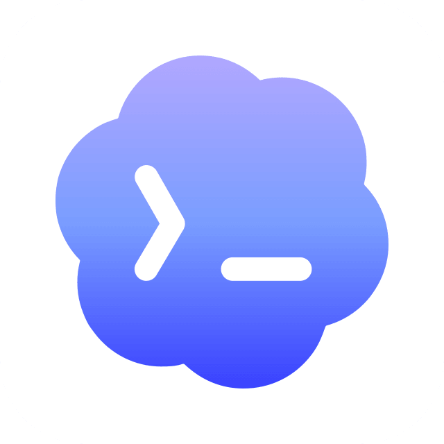
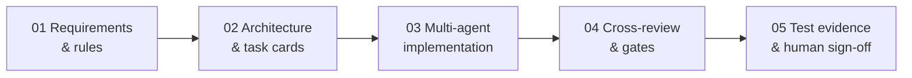
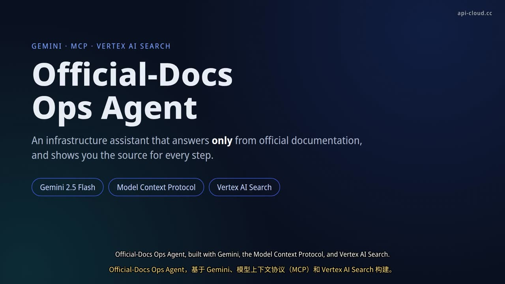

## Hi, I'm Pitt (Parker)

**AI FDE · AI-Native Infrastructure Engineering**

10+ years of enterprise IT infrastructure — from VMware / AD / Exchange data centers in GLP-regulated pharma and high-security environments, to Linux, cloud, observability and SRE. Today I build multi-agent engineering workflows that turn real business rules into production systems that can be verified and rolled back.

中文：十余年企业基础设施经验，现专注 AI FDE——用多 Agent 协同工程流程，把企业 AI 方案落成可运行、可验证的生产系统。

### Multi-agent workflow · 让多个 AI 按工程规则协作

  
  &nbsp;&nbsp;&nbsp;
  
  &nbsp;&nbsp;&nbsp;
  
  &nbsp;&nbsp;&nbsp;
  <picture><source media="(prefers-color-scheme: dark)" srcset="assets/grok-dark.png"></picture>
   
  Claude · Codex · Gemini · Grok

Plan review first, task breakdown, cross-validation between agents, official-docs lookup and automated gates — each step continues only on logs, tests and a human PASS.

### Running systems · 运行中的 AI 与基础设施实践

| | System | What it does |
|---|---|---|
| 📚 | **Official-docs knowledge base + MCP** | Curated official sources with cited retrieval and verification, so agents rely less on stale knowledge |
| 🛡️ | **AI hook gate system** | Enforces official-docs lookups and code checks, reducing drift and omissions during automated execution |
| 🌐 | **Multi-node security operations** | 12-node fleet across Asia, Europe and the US: automated access control, linked log-based defense, host-by-host verification, rollback-ready changes |
| ⚙️ | **K3s failover & observability lab** | Multi-ingress failover and monitoring pipeline, turned into reusable deployment and troubleshooting practice |

### Featured project

**[gemini-mcp-docs-agent](https://github.com/pittzhang20260507/gemini-mcp-docs-agent)** — MCP server + agent that answers infra/ops questions only from official upstream docs, with exact source citations. Built on Gemini and Vertex AI Search.

More write-ups: [engineering case studies](https://api-cloud.cc/case-studies.html) · [K8s observability](https://api-cloud.cc/k8s-observability.html). Most of my production work lives in private repositories; the case studies describe it.

### Tech I use daily

### Find me

[Blog · api-cloud.cc](https://api-cloud.cc) · [About](https://api-cloud.cc/about.html) · [Contact](https://api-cloud.cc/contact.html)
